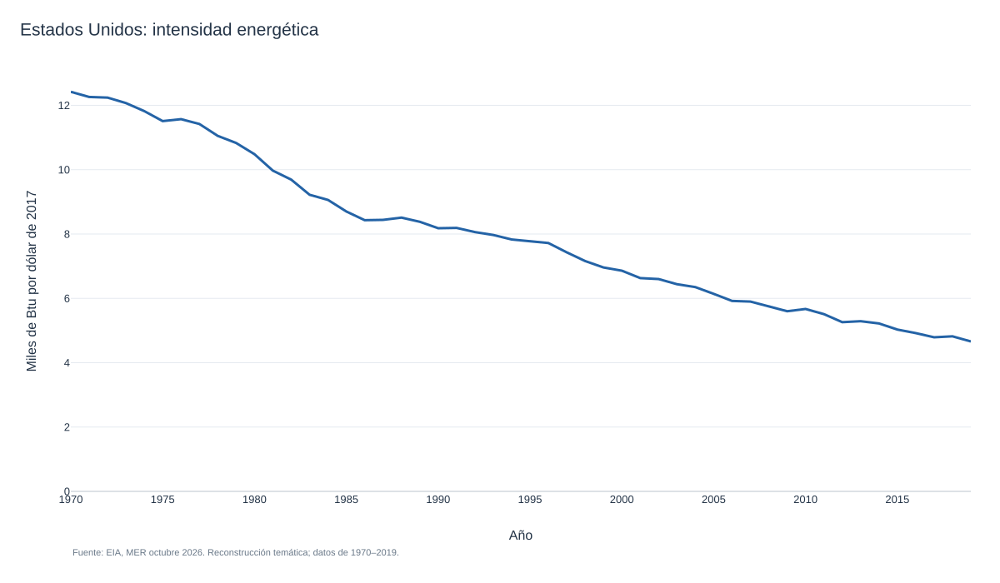
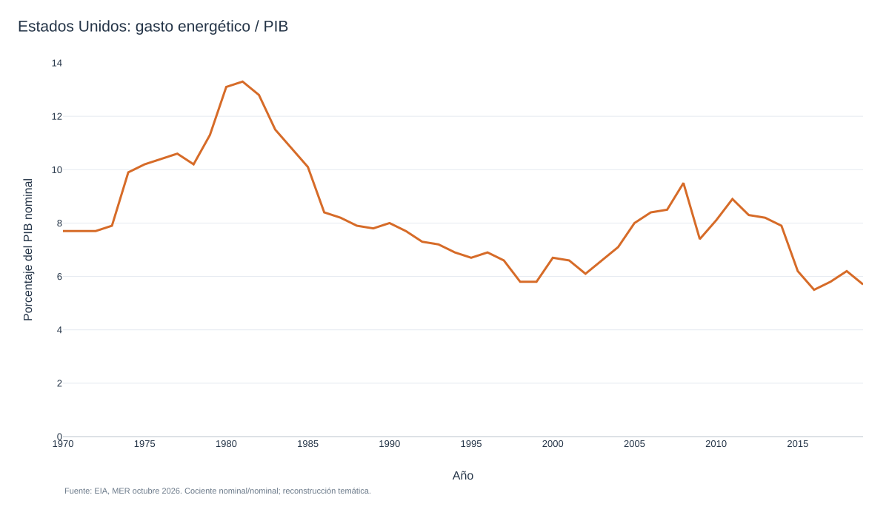

```{r setup, include=FALSE}
knitr::opts_chunk$set(echo = FALSE)
library(plotly)
library(shiny)
library(knitr)
opts_chunk$set(echo = TRUE)
```

# Crecimiento Económico \| Energía, población y crecimiento

## Datos sobre el uso de energía

-  El acervo Xt puede ser las “reservas totales probadas” de petróleo y gas natural.
-  El término Et es el flujo de estos recursos, o "energía", que entra en producción. 

## Datos sobre el uso de energía

<iframe width="1300" height="500" frameborder="0" scrolling="no" src="https://ourworldindata.org/grapher/primary-energy-cons?tab=chart&country=USA~CHN~IND~KOR~GBR~JPN~MEX~DEU">

</iframe>

## Datos sobre el uso de energía

-  En términos per cápita, las cosas se ven diferente. 

-  En particular, para países más ricos como Estados Unidos, Reino Unido o Japón, el uso de energía per cápita comenzó a caer en las últimas décadas. 

## Datos sobre el uso de energía

<iframe width="1300" height="500" frameborder="0" scrolling="no" src="https://ourworldindata.org/grapher/per-capita-energy-use?tab=chart&country=CHN~IND~JPN~GBR~USA~KOR~OWID_WRL~MEX~DEU">

</iframe>

## Datos sobre el uso de energía

-  Si miramos a todos los países, la relación entre el uso de energía per cápita y el PIB per cápita es positiva.

## Datos sobre el uso de energía

<iframe width="1300" height="500" frameborder="0" scrolling="no" src="https://ourworldindata.org/grapher/energy-use-per-capita-vs-gdp-per-capita?yScale=log&time=1990..2015">

</iframe>

## Datos sobre el uso de energía

-  La relación entre reservas y producción aumentó, lo que indica que los descubrimientos de reservas de combustibles fósiles aumentaban más rápido que el uso de energía.

```{r fig.align="center", fig.height = 4, fig.width = 7, echo=FALSE}
library(png)
library(grid)
Energy_Crude_Reserves <- readPNG("Energy-Crude_Reserves.png", native= TRUE, info=TRUE)

grid.raster(Energy_Crude_Reserves, interpolate=FALSE)
```

## Datos sobre el uso de energía

-  Los costos reales aumentaron con el tiempo, pero en los últimos años disminuyeron. 

-  Las nuevas series distinguen la intensidad energética física y el gasto energético como proporción del PIB. La primera usa energía/PIB real; la segunda, gasto nominal/PIB nominal, por lo que no deben confundirse sus unidades.

```{r fig.align="center", fig.height = 4, fig.width = 7, echo=FALSE}
library(png)
library(grid)
Energy_Energy_Expenditure <- readPNG("Energy-Energy_Expenditure.png", native= TRUE, info=TRUE)

grid.raster(Energy_Energy_Expenditure, interpolate=FALSE)
```

## Datos sobre el uso de energía

- La caída de $\beta$ también podría deberse a una caída en el precio de la energía o a una caída en la relación E / Y, algo que a veces se denomina "intensidad energética". 

-   [**Intensidad energética de Estados Unidos**](../../graficas_reconstruidas/graficas/iguzmanvt-190.html)

<figure class="grafica-reconstruida">

<figcaption><small>Reconstrucción docente. Abra el enlace para consultar datos, método y fuentes.</small></figcaption>
</figure>


-   [**Gasto energético / PIB nominal de Estados Unidos**](../../graficas_reconstruidas/graficas/iguzmanvt-192.html)

<figure class="grafica-reconstruida">

<figcaption><small>Reconstrucción docente. Abra el enlace para consultar datos, método y fuentes.</small></figcaption>
</figure>


## Demografía y población

<iframe width="1300" height="500" frameborder="0" scrolling="no" src="https://ourworldindata.org/grapher/birth-rate-the-number-of-births-per-1000-people-in-the-population?country=CHN~USA+%28blacks%29~USA+%28whites%29~MEX~FRA~JPN~England+and+Wales">

</iframe>

## Demografía y población

<iframe width="1300" height="500" frameborder="0" scrolling="no" src="https://ourworldindata.org/grapher/children-per-woman-un?tab=chart&time=1950..latest&country=OWID_WRL~BGD~NGA~GHA~DEU~IND~GBR~USA~CHN~KOR~JPN">

</iframe>

## Demografía y población

<iframe width="1300" height="500" frameborder="0" scrolling="no" src="https://ourworldindata.org/grapher/children-per-woman-by-gdp-per-capita">

</iframe>

## Demografía y población

<iframe width="1300" height="500" frameborder="0" scrolling="no" src="https://ourworldindata.org/grapher/life-expectancy-vs-gdp-per-capita">

</iframe>
