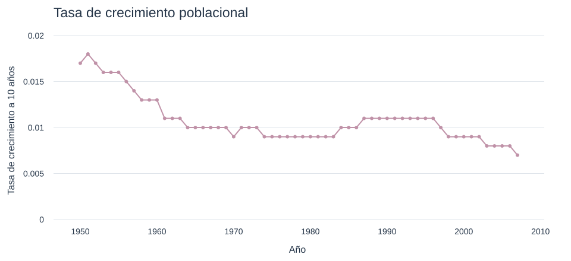

# Gráfica 223 de Mercado Laboral 2 recuperada

La [nota HTML histórica](../Crecimiento-Economico---Mercado-Laboral-2-Nota.html) conserva el respaldo de `iguzmanvt:223` dentro del iframe de la línea 903. Esta entrega extrae sus datos y ofrece una vista local que abre sin conexión, conservando el documento HTML histórico.



## Archivos

- [Vista HTML](grafica_223.html), con gráfica y tabla desplegable de las 58 observaciones. Descarga la carpeta y abre este archivo en el navegador.
- [SVG](grafica_223.svg), para consultar o incorporar la gráfica en materiales docentes.
- [CSV](grafica_223.csv), con los pares año–valor originales.
- [JSON](grafica_223.json), con procedencia, traza, diseño y fotogramas originales.
- [Procedimiento reproducible](recuperar_grafica_223.py), escrito con la biblioteca estándar de Python 3.

## Alcance y procedencia

El respaldo identifica una serie de Estados Unidos, con nombre `United States of America`, y contiene 58 años consecutivos de 1950 a 2007. Se conservan el título «Tasa de crecimiento poblacional», las etiquetas «Año» y «Tasa de crecimiento a 10 años», la línea y los puntos de color `#c092a8`, el intervalo vertical `[0, 0.02]` y el intervalo horizontal archivado `[1946.510993485342, 2010.489006514658]`.

Los valores decimales se conservan completos, incluidos `0.0180000000000001` en 1951 y `0.00700000000000003` en 2007. No se convierten a porcentajes ni se redondean. El respaldo no documenta proveedor, edición, definición de población, fórmula de cálculo, anualización o dirección temporal del intervalo de diez años. La recuperación acredita el contenido archivado y no valida su metodología ni actualiza la serie.

La figura aparece en la discusión docente de inmigración continua y crecimiento poblacional dentro del modelo de Solow. Su ubicación no demuestra que sea una simulación ni permite atribuir sus datos a los artículos mencionados en párrafos vecinos. Las referencias de cuadrícula `iguzmanvt:222` son identificadores de Chart Studio.

El dibujo SVG es una reconstrucción local. El JSON conserva los parámetros del diseño histórico, incluidos `autorange` y `hovermode`. La vista estática utiliza los rangos archivados y permite consultar cada par mediante los títulos de los puntos y la tabla HTML. No reproduce el zoom ni el menú de Chart Studio.

Fuente fija de la extracción

- Repositorio `iguzmanvt/Crecimiento`, [commit d8216e8](https://github.com/iguzmanvt/Crecimiento/blob/d8216e86cbf822a798ec72ac6433a26c20c8cfca/Clases_Crecimiento_Economico/Labor_2/Crecimiento-Economico---Mercado-Laboral-2-Nota.html#L903).
- Blob Git `d35266c14a35b05f3a76a9d7e9a317fa910c0cdb`.
- SHA-256 de la fuente con saltos LF `774bba6dd74789ec022b3cb3e888d29074e18910360b8bc10f4c1628c3367638`.
- Dentro del respaldo, `plot-fid` identifica `iguzmanvt:223`; `plot-data` contiene la traza y `plot-layout` el diseño. Sus huellas exactas están en el JSON y se exigen durante la extracción.

## Reproducción y aceptación

Desde la raíz del repositorio, ejecutar

```sh
python Clases_Crecimiento_Economico/Labor_2/recuperado/recuperar_grafica_223.py
```

El script verifica la huella de la nota histórica y exige un único respaldo de la gráfica 223, sus 58 años y valores finitos. Después regenera JSON, CSV, SVG y HTML. Los cuatro resultados fijan saltos LF para conservar el mismo contenido en Windows y Linux. Se acepta la conversión LF→CRLF del checkout de la nota original. El procedimiento no ejecuta su código HTML ni necesita red o paquetes externos.

La aceptación requiere igualdad completa de los 58 pares entre respaldo, JSON, CSV, SVG y tabla HTML; etiquetas, color y rangos conservados; apertura sin red; reproducción idéntica de los cuatro resultados en Linux y Windows; y preservación de los originales en Git.

## Límites de esta entrega

Se recupera una gráfica. La nota HTML histórica se conserva intacta. Desde el 11 de noviembre de 2026, las tres fuentes R Markdown enlazan esta vista local y muestran su SVG. El renderizador copia los recursos a una salida separada; no debe sobrescribirse el HTML histórico. Los demás materiales y recursos externos del capítulo mantienen su estado anterior.
