```{r setup, include=FALSE}
knitr::opts_chunk$set(echo = FALSE)
library(plotly)
library(shiny)
library(knitr)
opts_chunk$set(echo = TRUE)
```

### **Dinámicas y correlaciones**

- [**Correlación con la inversión**](../../graficas_reconstruidas/graficas/iguzmanvt-160.html)

<figure class="grafica-reconstruida">
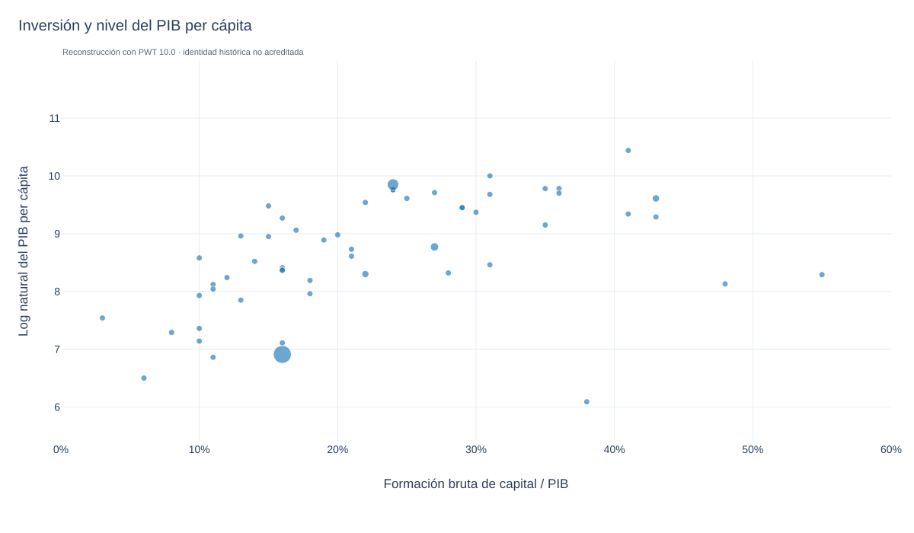
<figcaption><small>Reconstrucción docente. Abra el enlace para consultar datos, método y fuentes.</small></figcaption>
</figure>


- [**Correlación con el crecimiento poblacional**](../../graficas_reconstruidas/graficas/iguzmanvt-162.html)

<figure class="grafica-reconstruida">
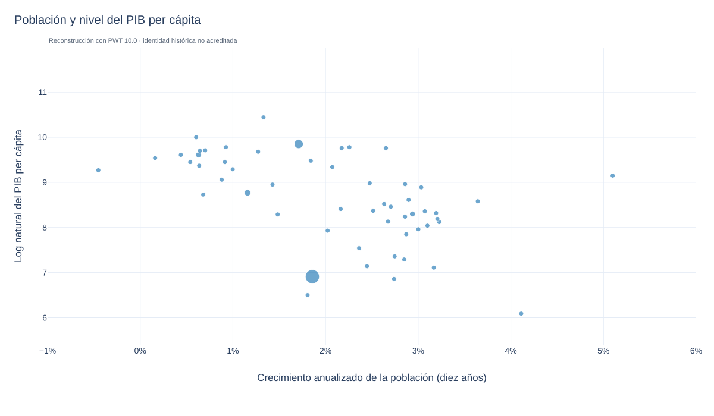
<figcaption><small>Reconstrucción docente. Abra el enlace para consultar datos, método y fuentes.</small></figcaption>
</figure>


- [**Dinámica de productividd**](../../graficas_reconstruidas/graficas/iguzmanvt-78.html)

<figure class="grafica-reconstruida">
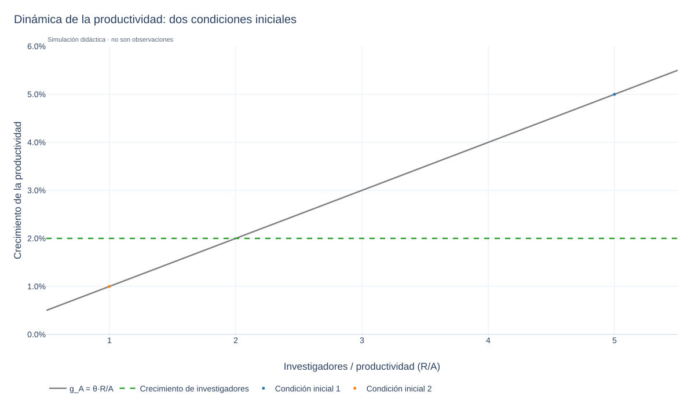
<figcaption><small>Reconstrucción docente. Abra el enlace para consultar datos, método y fuentes.</small></figcaption>
</figure>


- [**Nivel del PIB per cápita**](../../graficas_reconstruidas/graficas/iguzmanvt-82.html)

<figure class="grafica-reconstruida">
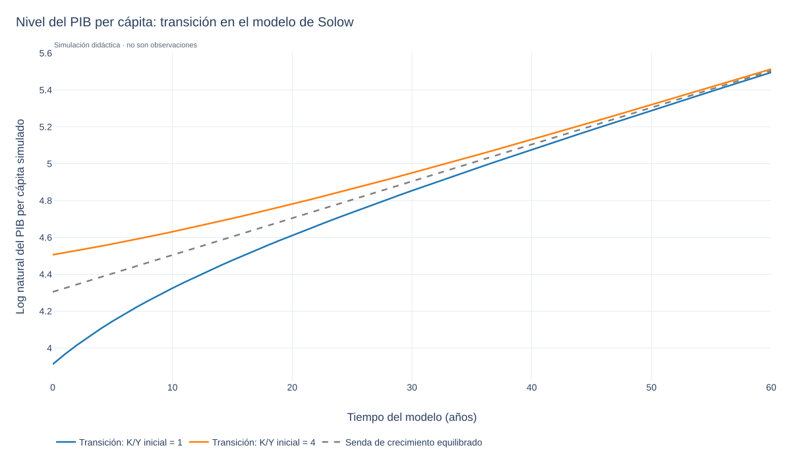
<figcaption><small>Reconstrucción docente. Abra el enlace para consultar datos, método y fuentes.</small></figcaption>
</figure>


### **Estudios de caso usando el modelo de Solow**

- **Estados Unidos**

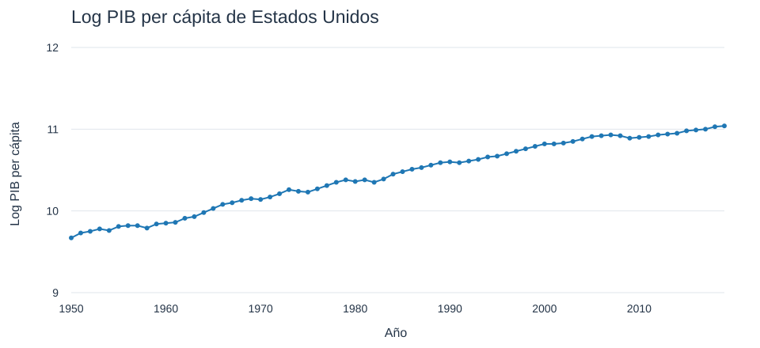

[Vista local, datos y límites de la recuperación](recuperado/grafica_42.html)

- [**Estados Unidos**](../../graficas_reconstruidas/graficas/iguzmanvt-46.html) - BGP 1

<figure class="grafica-reconstruida">
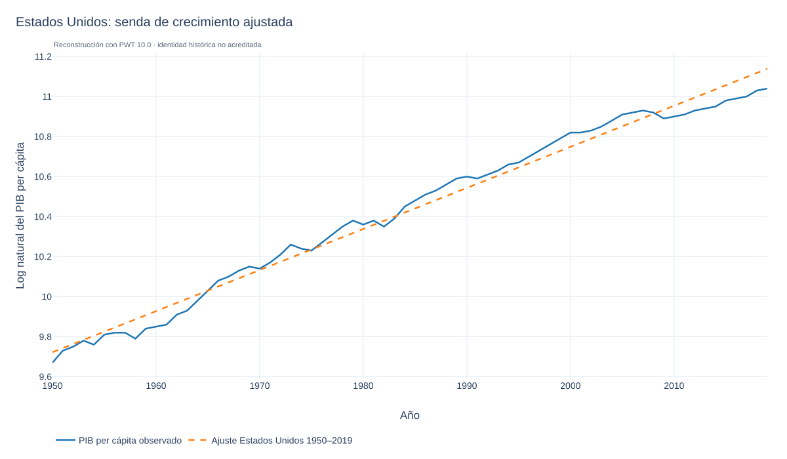
<figcaption><small>Reconstrucción docente. Abra el enlace para consultar datos, método y fuentes.</small></figcaption>
</figure>


**Especificación de la reconstrucción:** La recta utiliza todo el periodo 1950–2019: pendiente anual logarítmica de aproximadamente 2.052%. Es un ajuste descriptivo.

- [**Estados Unidos**](../../graficas_reconstruidas/graficas/iguzmanvt-48.html) - BGP 2

<figure class="grafica-reconstruida">
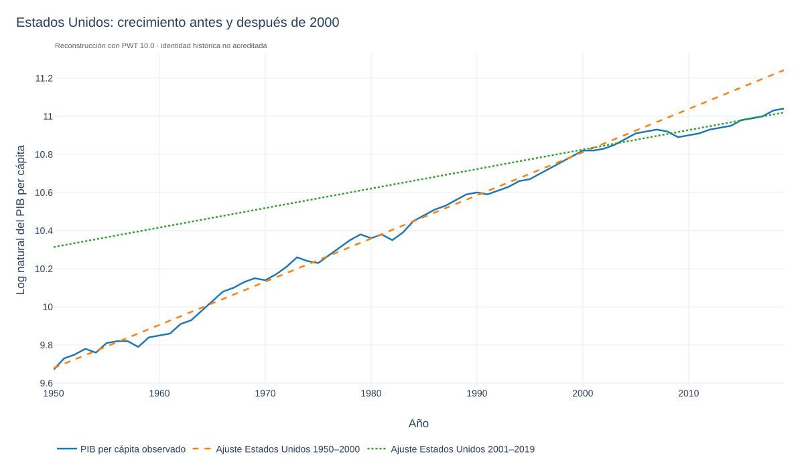
<figcaption><small>Reconstrucción docente. Abra el enlace para consultar datos, método y fuentes.</small></figcaption>
</figure>


**Especificación de la reconstrucción:** La recta naranja usa 1950–2000 (2.2647% anual logarítmico); la verde, 2001–2019 (1.0228%). Prolongar las rectas fuera de esas ventanas no equivale a un pronóstico.

-   **Estados Unidos**

    -   La reconstrucción BGP 1 ajusta una recta al logaritmo del PIB per cápita de 1950–2019. BGP 2 compara las rectas ajustadas a 1950–2000 (naranja) y 2001–2019 (verde).
    
    -   Las rectas se estiman por mínimos cuadrados con PWT 10.0; sus pendientes son tasas logarítmicas medias ajustadas. Fuera de cada ventana son extrapolaciones descriptivas, no observaciones ni pronósticos.
    
    -   ¿La caída del PIB per cápita por debajo del antiguo BGP (naranja) refleja un cambio permanente en el nivel del PIB per cápita, o si se trata de una desviación temporal, como a fines de la década de 1950 y principios de la de 1960? Esta pregunta tiene enormes implicaciones para el nivel futuro del PIB per cápita.

    -   Podemos representar la recta de 1950–2000 mediante la fórmula de Solow, midiendo t desde 1950. Es una calibración ilustrativa, no una estimación estructural:

$$
\ln y_t^{BGP} = \frac{\alpha}{1-\alpha} \left(\ln s_I - \ln(\delta + g_A + g_L) \right) + \ln A_0 + g_A t.
$$

-   La recta naranja ajustada a 1950–2000 tiene la siguiente pendiente, usada como g_A en esta calibración:

$g_A = 0.022647$ (aproximadamente 2.2647% anual logarítmico).

-   Para ilustrar la fórmula, mantenemos los supuestos:

$\alpha \approx 0.3$
$\delta \approx 0.05$

-   Con los datos de USA 1950–2000 calculamos g_L como el crecimiento logarítmico anualizado de la población y usamos el promedio de csh_i como aproximación a s_I. Esta proporción a PPP corrientes no es contablemente idéntica a una tasa de inversión a precios nacionales constantes:

$g_L = 0.011874$
$s_I = 0.247932$

-   El resultado es:

$$
9.679118 \approx \frac{0.3}{1-0.3} \left(\ln 0.247932 - \ln(0.05 + 0.022647 + 0.011874) \right) + \ln A_0
$$

-   Lo único que no sabemos aquí es $A_0$, el nivel de tecnología en 1950. Despejando:

$$
\ln A_0 \approx 9.679118 - \frac{0.3}{1-0.3} \left(\ln 0.247932 - \ln(0.05 + 0.022647 + 0.011874) \right) \approx 9.217909.
$$

-   Lo que implica que:
    
$A_0 \approx 10\,076$

-   A_0 es una escala residual que hace compatible la tendencia ajustada con los supuestos del modelo; no representa unidades observables de tecnología.
    
-   Una comparación entre países requiere definiciones, unidades y parámetros coherentes; este A_0 calibrado no es directamente el índice de PTF publicado por PWT.

- [**Alemania**](../../graficas_reconstruidas/graficas/iguzmanvt-50.html) - BGP

<figure class="grafica-reconstruida">
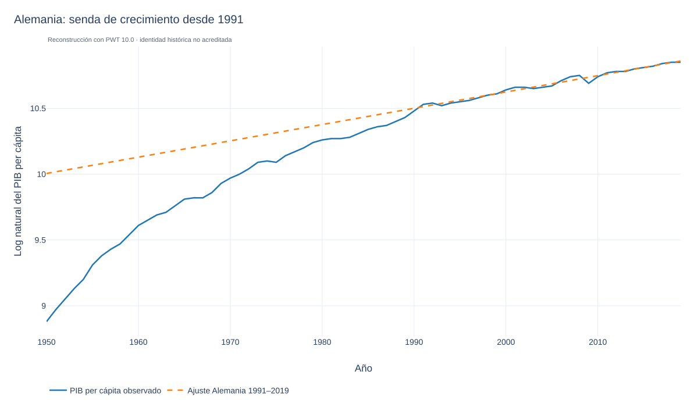
<figcaption><small>Reconstrucción docente. Abra el enlace para consultar datos, método y fuentes.</small></figcaption>
</figure>


**Especificación de la reconstrucción:** La tendencia se ajusta a Alemania en 1991–2019; se dibuja sobre la serie disponible para distinguir ajuste y extrapolación.

- [**Alemania**](../../graficas_reconstruidas/graficas/iguzmanvt-52.html) - Proporción K/Y

<figure class="grafica-reconstruida">
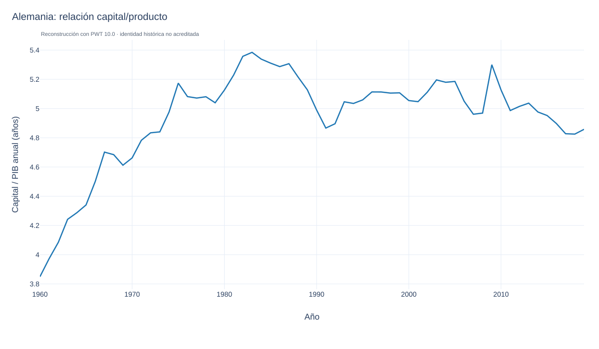
<figcaption><small>Reconstrucción docente. Abra el enlace para consultar datos, método y fuentes.</small></figcaption>
</figure>


- [**Corea del Sur**](../../graficas_reconstruidas/graficas/iguzmanvt-54.html) - BGP

<figure class="grafica-reconstruida">
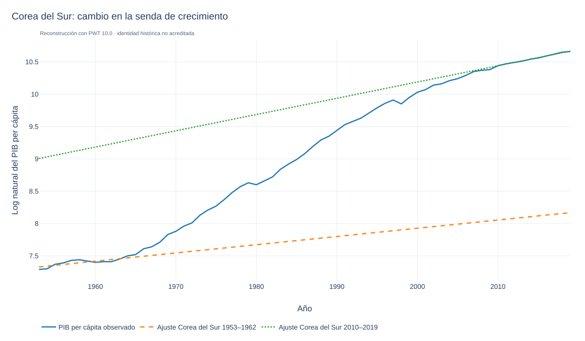
<figcaption><small>Reconstrucción docente. Abra el enlace para consultar datos, método y fuentes.</small></figcaption>
</figure>


**Especificación de la reconstrucción:** Se comparan tendencias de Corea del Sur ajustadas a 1953–1962 y 2010–2019. Las rectas son referencias descriptivas, no observaciones del BGP.

- [**Corea del Sur**](../../graficas_reconstruidas/graficas/iguzmanvt-122.html) - Proporción K/Y

<figure class="grafica-reconstruida">
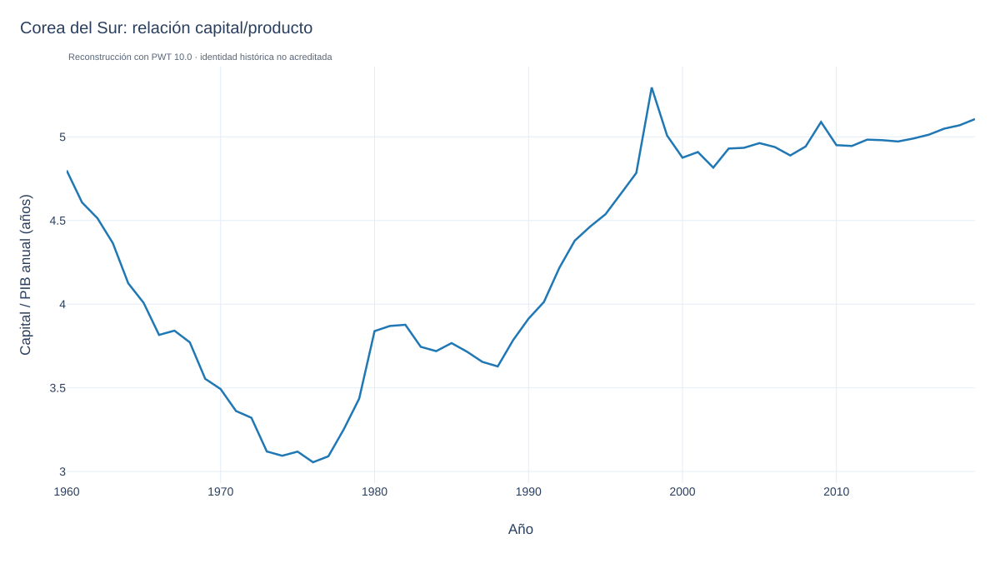
<figcaption><small>Reconstrucción docente. Abra el enlace para consultar datos, método y fuentes.</small></figcaption>
</figure>


- [**Corea del Sur**](../../graficas_reconstruidas/graficas/iguzmanvt-124.html) - Crecimiento poblacional

<figure class="grafica-reconstruida">
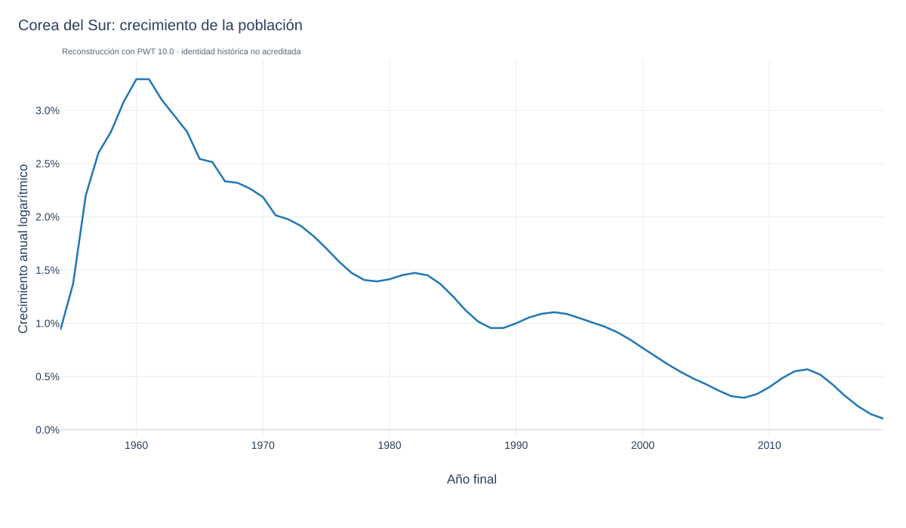
<figcaption><small>Reconstrucción docente. Abra el enlace para consultar datos, método y fuentes.</small></figcaption>
</figure>


- [**China**](../../graficas_reconstruidas/graficas/iguzmanvt-56.html) - BGP

<figure class="grafica-reconstruida">
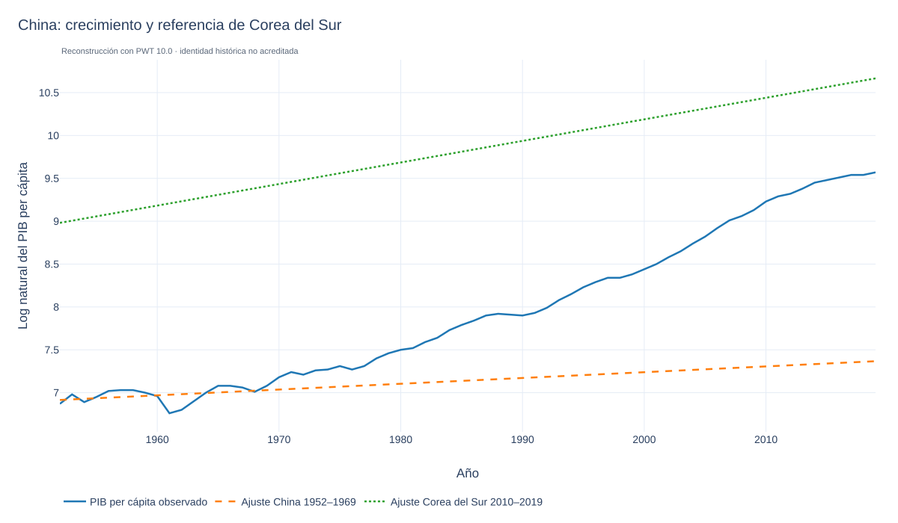
<figcaption><small>Reconstrucción docente. Abra el enlace para consultar datos, método y fuentes.</small></figcaption>
</figure>


**Especificación de la reconstrucción:** La referencia temprana se ajusta a China en 1952–1969; la segunda recta usa Corea del Sur en 2010–2019. Es una comparación ilustrativa y no prueba convergencia a esa trayectoria.

- [**China**](../../graficas_reconstruidas/graficas/iguzmanvt-126.html) - Proporción K/Y

<figure class="grafica-reconstruida">
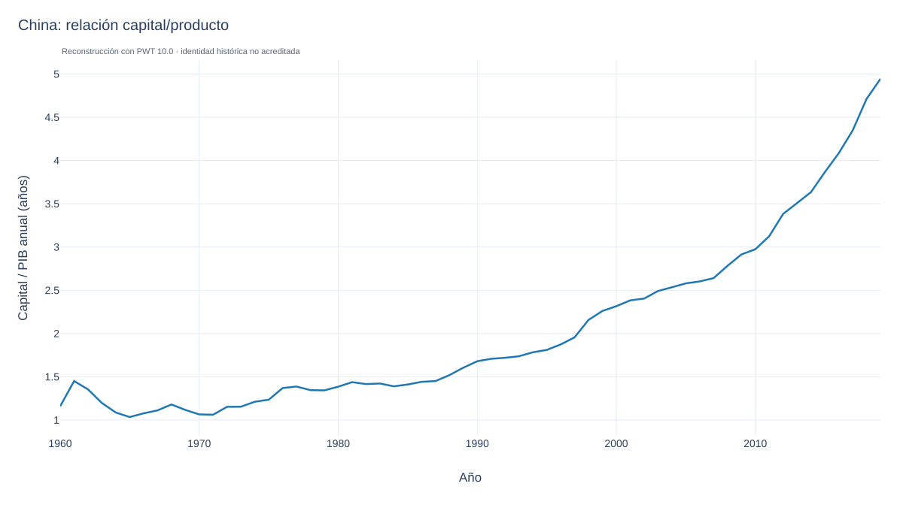
<figcaption><small>Reconstrucción docente. Abra el enlace para consultar datos, método y fuentes.</small></figcaption>
</figure>


- [**China**](../../graficas_reconstruidas/graficas/iguzmanvt-58.html) - Crecimiento poblacional

<figure class="grafica-reconstruida">
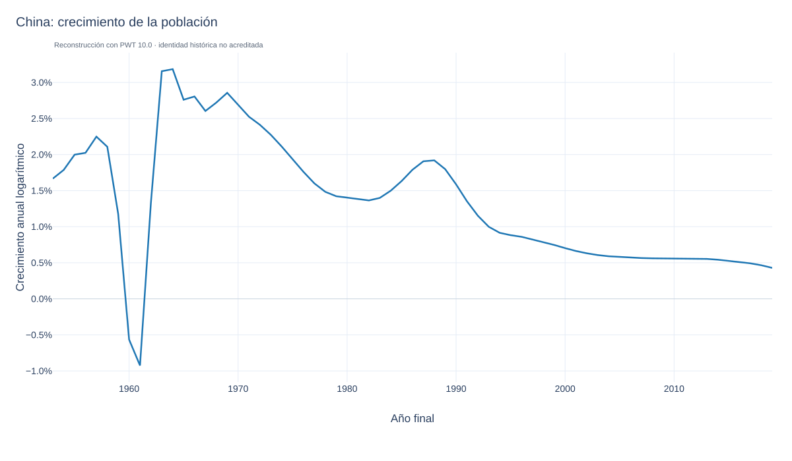
<figcaption><small>Reconstrucción docente. Abra el enlace para consultar datos, método y fuentes.</small></figcaption>
</figure>


- [**China**](../../graficas_reconstruidas/graficas/iguzmanvt-60.html) - Transición al BGP

<figure class="grafica-reconstruida">
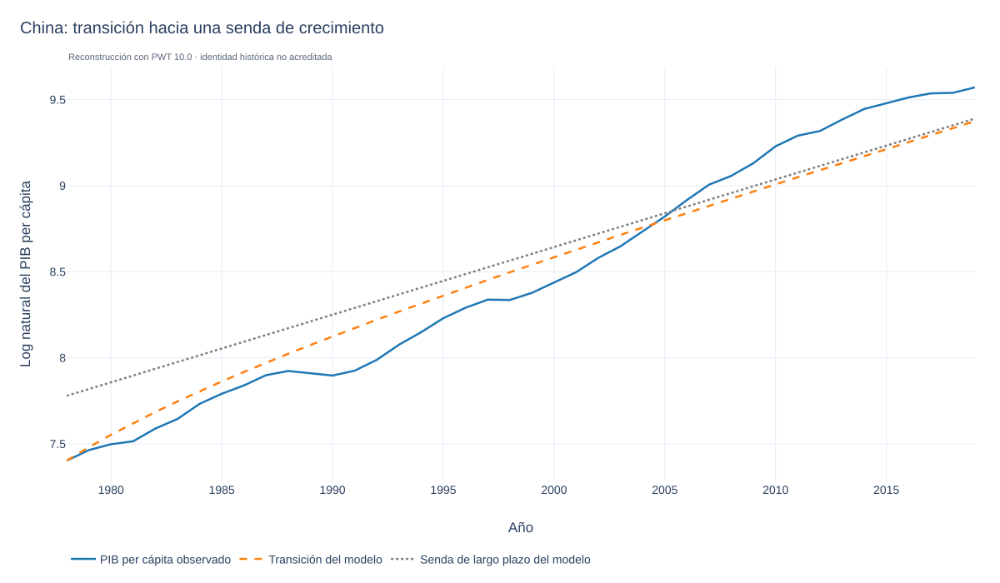
<figcaption><small>Reconstrucción docente. Abra el enlace para consultar datos, método y fuentes.</small></figcaption>
</figure>


**Especificación de la reconstrucción:** La transición de Solow se calibra a China en 1978–2019 con α=0.3 y δ=0.05. La inversión usa el promedio de csh_i; población y productividad residual se calibran con los extremos del periodo. La trayectoria del modelo se distingue de los datos observados.

- [**China**](../../graficas_reconstruidas/graficas/iguzmanvt-62.html) - Diferentes BGP

<figure class="grafica-reconstruida">
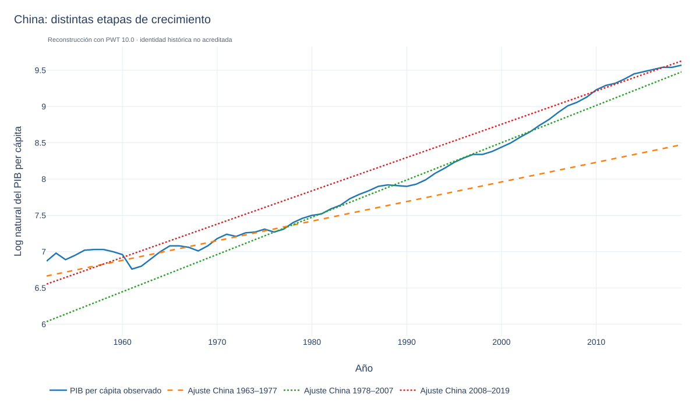
<figcaption><small>Reconstrucción docente. Abra el enlace para consultar datos, método y fuentes.</small></figcaption>
</figure>


**Especificación de la reconstrucción:** Se comparan tendencias OLS de China en 1963–1977, 1978–2007 y 2008–2019. Estos cortes son decisiones explícitas de la reconstrucción.

- [**Japón**](../../graficas_reconstruidas/graficas/iguzmanvt-44.html) - Distintos BGP

<figure class="grafica-reconstruida">
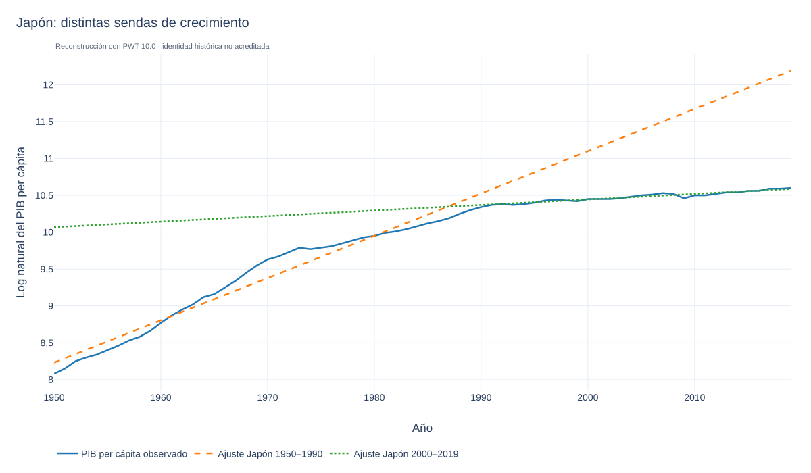
<figcaption><small>Reconstrucción docente. Abra el enlace para consultar datos, método y fuentes.</small></figcaption>
</figure>


**Especificación de la reconstrucción:** Se compara el PIB per cápita de Japón con tendencias OLS ajustadas a 1950–1990 y 2000–2019. Las ventanas son una adaptación documentada, no especificaciones recuperadas del gráfico original.
