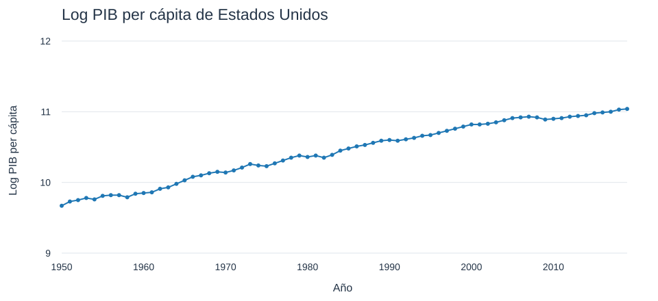

```{r setup, include=FALSE}
knitr::opts_chunk$set(echo = FALSE)
library(plotly)
library(shiny)
library(knitr)
opts_chunk$set(echo = TRUE)
```

# Crecimiento Económico \| Estudios de caso usando el modelo de Solow

## Correlación con la inversión

<iframe width="1300" height="400" frameborder="0" scrolling="no" src="//plotly.com/~iguzmanvt/160.embed">

</iframe>

## Correlación con el crecimiento poblacional

<iframe width="1300" height="400" frameborder="0" scrolling="no" src="//plotly.com/~iguzmanvt/162.embed">

</iframe>

## Estudios de caso usando el modelo de Solow


 <iframe width="1300" height="400" frameborder="0" scrolling="no" src="//plotly.com/~iguzmanvt/78.embed">

</iframe>

## Nivel del PIB per cápita


 <iframe width="1300" height="400" frameborder="0" scrolling="no" src="//plotly.com/~iguzmanvt/82.embed">

</iframe>


## Estudios de caso usando el modelo de Solow



[Vista local, datos y límites de la recuperación](recuperado/grafica_42.html)

## Estudios de caso usando el modelo de Solow

 
 <iframe width="1300" height="400" frameborder="0" scrolling="no" src="//plotly.com/~iguzmanvt/46.embed">

</iframe>

## Estudios de caso usando el modelo de Solow


 <iframe width="1300" height="400" frameborder="0" scrolling="no" src="//plotly.com/~iguzmanvt/48.embed">

</iframe>

## Estudios de caso usando el modelo de Solow

-   **Estados Unidos**

    -   ¿Cuál es la estimación correcta? Podemos ajustar los parámetros para mover un BGP hacia arriba y hacia abajo. 
    
    -   Esas líneas de BGP en la figura están moviendo esos parámetros hacia arriba y hacia abajo hasta que la línea se ajuste a la evidencia sobre el PIB per cápita.
    
    -   ¿La caída del PIB per cápita por debajo del antiguo BGP (naranja) refleja un cambio permanente en el nivel del PIB per cápita, o si se trata de una desviación temporal, como a fines de la década de 1950 y principios de la de 1960? Esta pregunta tiene enormes implicaciones para el nivel futuro del PIB per cápita.

## Estudios de caso usando el modelo de Solow

-   **Estados Unidos**

    -   Podemos estimar el BGP de Estados Unidos con la fórmula respectiva:

$$
\ln y_t^{BGP} = \frac{\alpha}{1-\alpha} \left(\ln s_I - \ln(\delta + g_A + g_L) \right) + \ln A_0 + g_A t.
$$

    -   La BGP naranja me da: 

$g_A=0.0208$

    -   La literatura indica que:

$\alpha \approx 0.3$
$\delta \approx 0.05$

    -   Podemos estimar 𝑛 y 𝑠 de los datos para el periodo:

$n = 0.011$
$s = 0.249$

## Estudios de caso usando el modelo de Solow

-   **Estados Unidos**

    -   El resultado es:

$$
9.58 \approx \frac{.3}{1-.3} \left(\ln 0.249 - \ln(.05 + .02 + .011) \right) + \ln A_0
$$

    -   Lo único que no sabemos aquí es 𝐴_0, el nivel de tecnología en 1950. Despejando:

$$
\ln A_0 \approx 9.58- \frac{.3}{1-.3} \left(\ln 0.249 - \ln(.05 + .02 + .011) \right) = 9.10. 
$$

    -   Lo que implica que:
    
$A_0 = 8,955$

    -   ¿Qué significa esto? 8,955 niveles de tecnología no significa nada por si mismo. Pero garantiza un nivel de tecnología en donde se puedan ajustar los demás parámetros.
    
    -   Además es interesante porque podemos compararlo con el nivel de tecnología de otros países.

## Estudios de caso usando el modelo de Solow

 <iframe width="1300" height="400" frameborder="0" scrolling="no" src="//plotly.com/~iguzmanvt/50.embed">

</iframe>

## Estudios de caso usando el modelo de Solow

 <iframe width="1300" height="400" frameborder="0" scrolling="no" src="//plotly.com/~iguzmanvt/52.embed">

</iframe>

## Estudios de caso usando el modelo de Solow

 <iframe width="1300" height="400" frameborder="0" scrolling="no" src="//plotly.com/~iguzmanvt/54.embed">

</iframe>

## Estudios de caso usando el modelo de Solow

 <iframe width="1300" height="400" frameborder="0" scrolling="no" src="//plotly.com/~iguzmanvt/122.embed">

</iframe>

## Estudios de caso usando el modelo de Solow

 <iframe width="1300" height="400" frameborder="0" scrolling="no" src="//plotly.com/~iguzmanvt/124.embed">

</iframe>

## Estudios de caso usando el modelo de Solow

 <iframe width="1300" height="400" frameborder="0" scrolling="no" src="//plotly.com/~iguzmanvt/56.embed">

</iframe>

## Estudios de caso usando el modelo de Solow

 <iframe width="1300" height="400" frameborder="0" scrolling="no" src="//plotly.com/~iguzmanvt/126.embed">

</iframe>

## Estudios de caso usando el modelo de Solow

 <iframe width="1300" height="400" frameborder="0" scrolling="no" src="//plotly.com/~iguzmanvt/58.embed">

</iframe>

## Estudios de caso usando el modelo de Solow

 <iframe width="1300" height="400" frameborder="0" scrolling="no" src="//plotly.com/~iguzmanvt/60.embed">

</iframe>

## Estudios de caso usando el modelo de Solow

 <iframe width="1300" height="400" frameborder="0" scrolling="no" src="//plotly.com/~iguzmanvt/62.embed">

</iframe>

## Estudios de caso usando el modelo de Solow

 <iframe width="1300" height="400" frameborder="0" scrolling="no" src="//plotly.com/~iguzmanvt/44.embed">

</iframe>