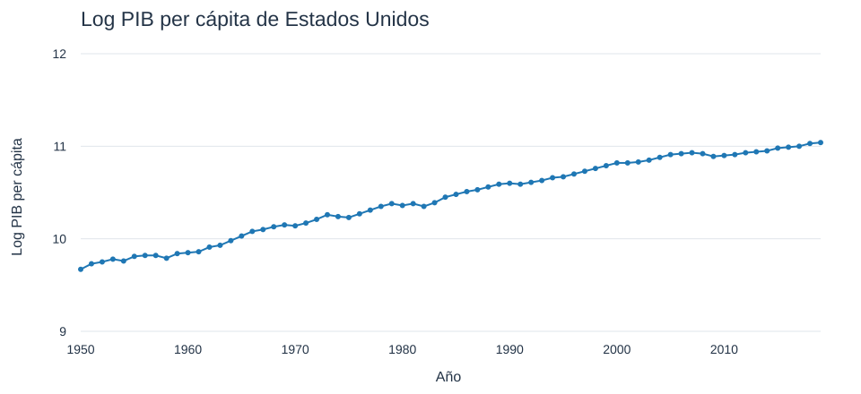

# Gráfica 42 de Solow recuperada

La [nota HTML histórica](../Crecimiento-Economico-2-Nota.html) conserva los datos de la gráfica `iguzmanvt:42` dentro de una página Chart Studio codificada en un atributo `img`. Ese respaldo depende de scripts externos antiguos y no funciona como imagen. Esta entrega extrae sus datos y ofrece una vista local que abre sin conexión.



## Archivos

- [Vista HTML](grafica_42.html), con gráfica y tabla desplegable de las 70 observaciones. Descarga la carpeta y abre este archivo en el navegador.
- [SVG](grafica_42.svg), para consultar o incorporar la gráfica en materiales docentes.
- [CSV](grafica_42.csv), con los pares año–valor tal como aparecen en el respaldo.
- [JSON](grafica_42.json), con procedencia, traza, diseño y fotogramas originales.
- [Procedimiento reproducible](recuperar_grafica_42.py), escrito con la biblioteca estándar de Python 3.

## Alcance y procedencia

Se conserva una serie USA, 70 años consecutivos de 1950 a 2019, el título «Log PIB per cápita de Estados Unidos», las etiquetas «Año» y «Log PIB per cápita», el intervalo vertical de 9 a 12 y la representación azul con línea y puntos. Los valores extremos son 9.67 y 11.04. Los valores archivados se conservan con la precisión disponible.

La vista SVG es una reconstrucción del dibujo. El JSON conserva también los parámetros históricos que la vista estática no implementa, como `hovermode`. El HTML permite consultar todos los valores en una tabla y los puntos del SVG muestran año y valor al situar el cursor. No se ofrece el zoom ni el menú de Chart Studio.

El respaldo no documenta el proveedor y edición de la serie estadística, la moneda, la base de precios, el ajuste ni la base del logaritmo. Los identificadores de cuadrícula `iguzmanvt:41:8986ee` y `iguzmanvt:41:7fcb9c` son referencias de Chart Studio. Esta recuperación acredita el contenido del archivo docente, sin actualizarlo ni atribuirle una fuente estadística no verificada.

Fuente fija de la extracción

- Repositorio `iguzmanvt/Crecimiento`, [commit 504f34e](https://github.com/iguzmanvt/Crecimiento/blob/504f34e277cb4d88b153ac45916532383658590c/Clases_Crecimiento_Economico/Solow/Crecimiento-Economico-2-Nota.html).
- Blob Git `3c85661b5e46fabcd10b15517ab7853b1721beea`.
- SHA-256 de la fuente con saltos LF `18daf44f6b29b25e0ba9a0ae626ad6f1eb8ac4b86f1f985a7873992c9e2e3b8a`.
- Dentro del respaldo, `plot-fid` identifica `iguzmanvt:42`; `plot-data` contiene la traza y `plot-layout` el diseño. Las huellas de ambos textos están en el JSON y se exigen durante la extracción.

## Reproducción y aceptación

Desde la raíz del repositorio, ejecutar

```sh
python Clases_Crecimiento_Economico/Solow/recuperado/recuperar_grafica_42.py
```

El script verifica la huella del archivo histórico, identifica un único respaldo de la gráfica 42 y exige sus 70 años y valores finitos. Después regenera JSON, CSV, SVG y HTML con saltos LF. Acepta la conversión LF→CRLF del checkout de Windows, sin modificar la fuente. No ejecuta código del HTML archivado ni necesita acceso a internet o paquetes externos.

La aceptación requiere igualdad de los 70 pares entre el respaldo, JSON, CSV y los puntos dibujados; etiquetas e intervalo vertical conservados; apertura del HTML sin red; reproducción idéntica de los cuatro resultados en Linux y Windows; y conservación de los originales en Git.

## Pendiente

La entrega recupera una gráfica. Las otras 17 referencias externas de la nota de Solow siguen pendientes de recuperar desde sus propios respaldos. La nota HTML histórica se conserva intacta. Desde el 11 de noviembre de 2026, las dos fuentes R Markdown enlazan esta vista local y muestran su SVG. El renderizador copia los recursos a una salida separada; no debe sobrescribirse el HTML histórico.

Identificadores pendientes de `iguzmanvt` en la nota, en su orden original: `160`, `162`, `78`, `82`, `46`, `48`, `50`, `52`, `54`, `122`, `124`, `56`, `126`, `58`, `60`, `62`, `44`.
